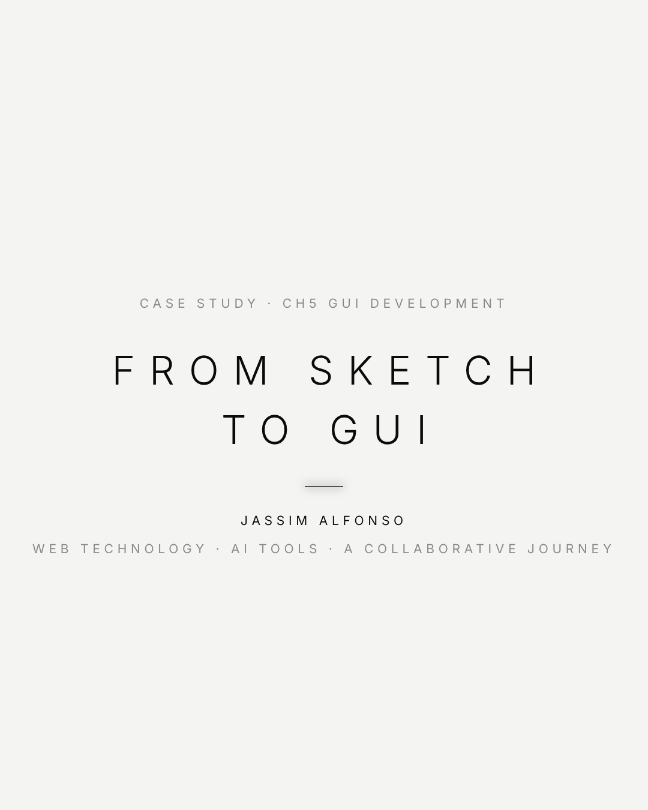
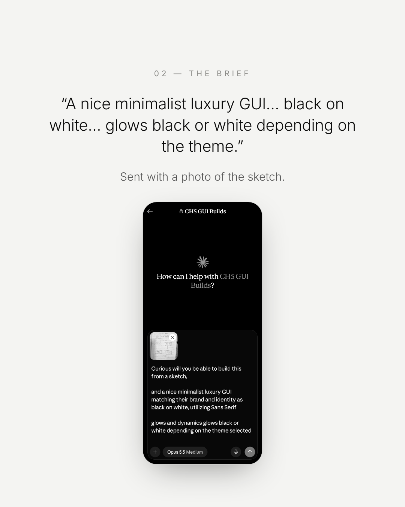
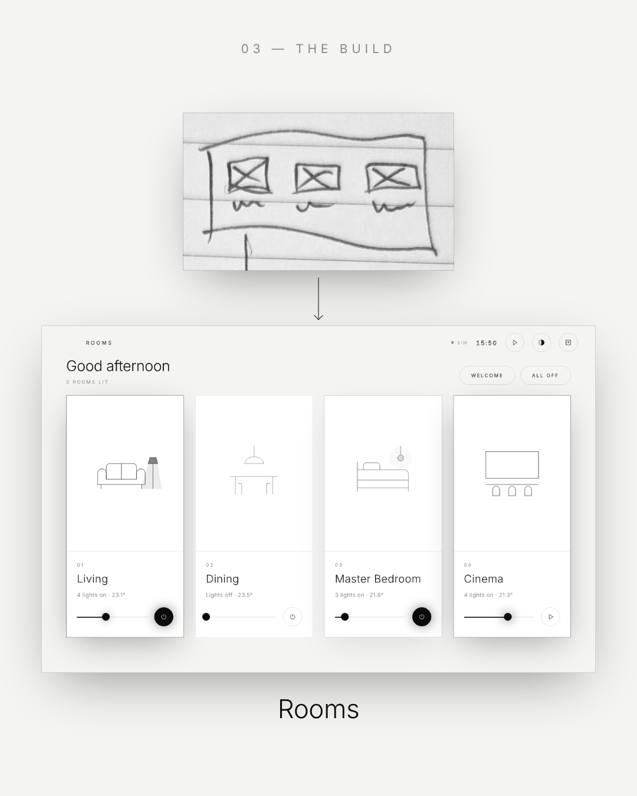
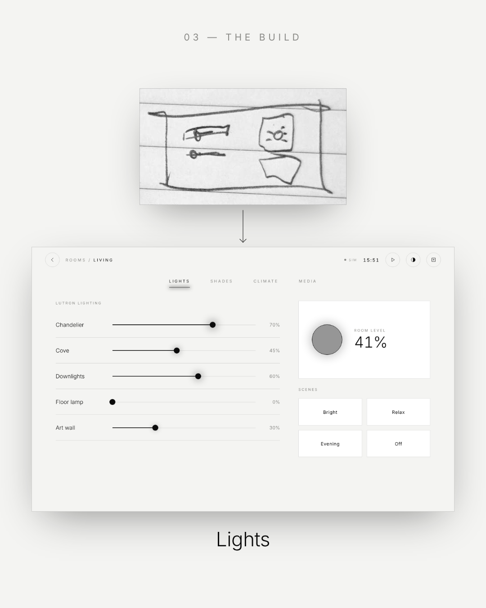
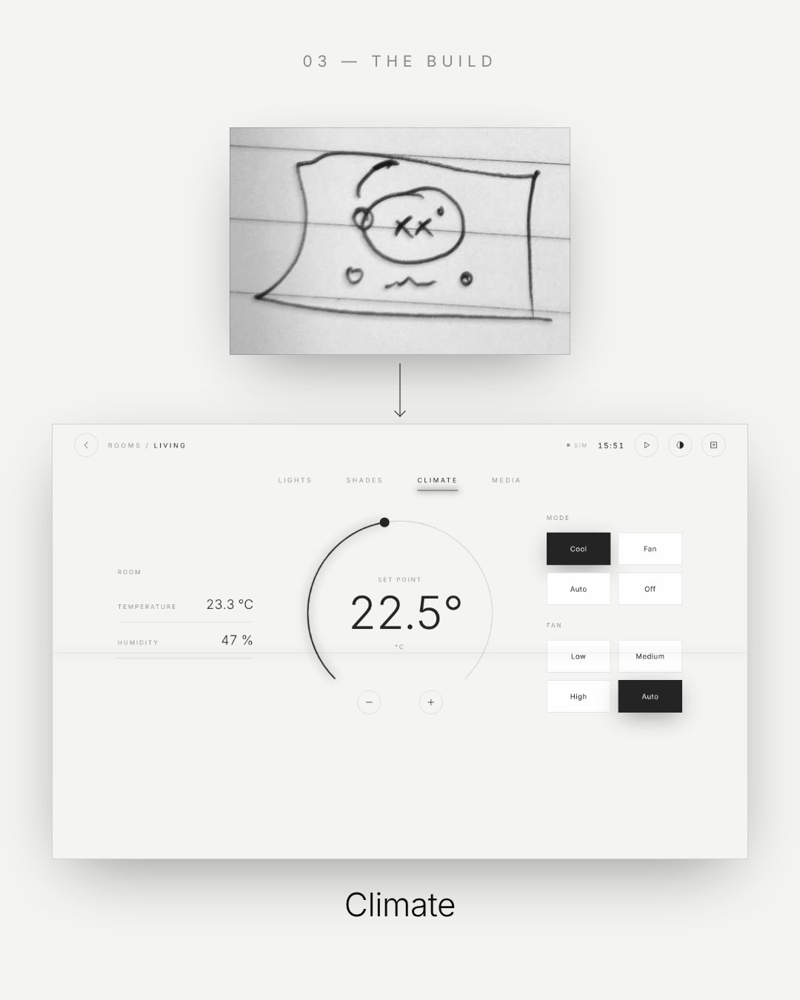
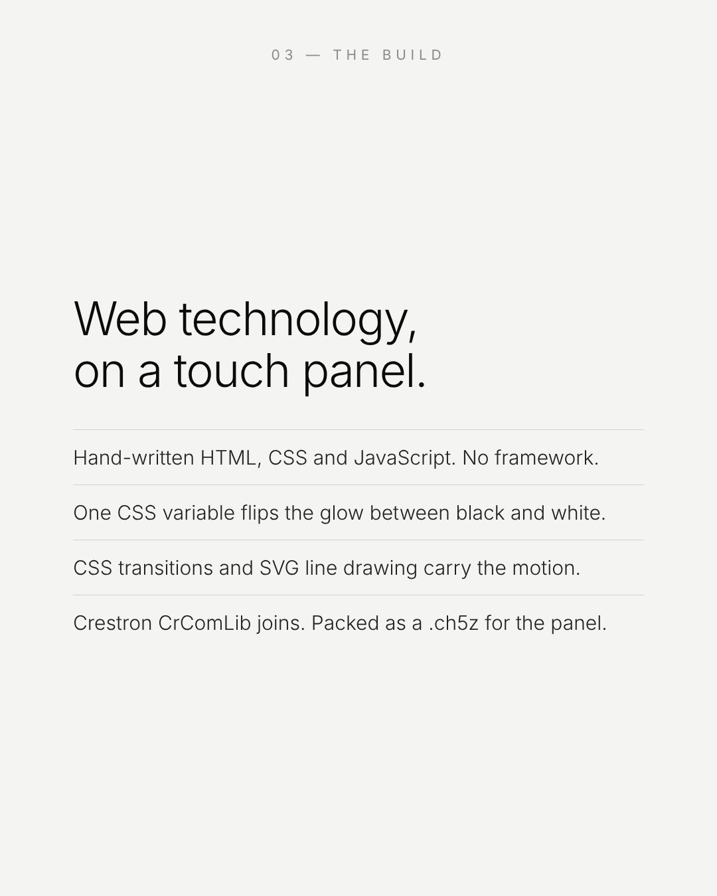
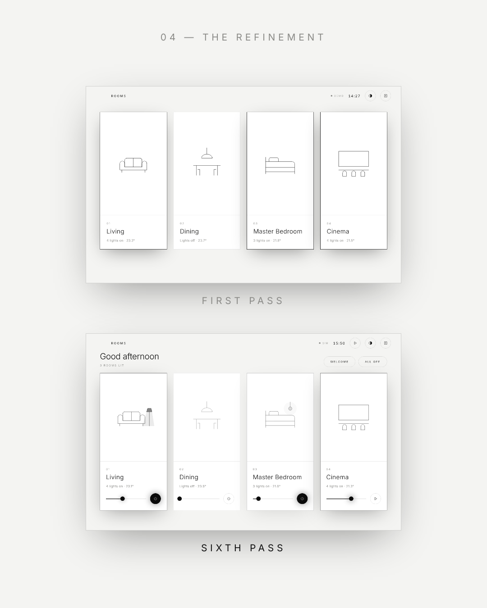
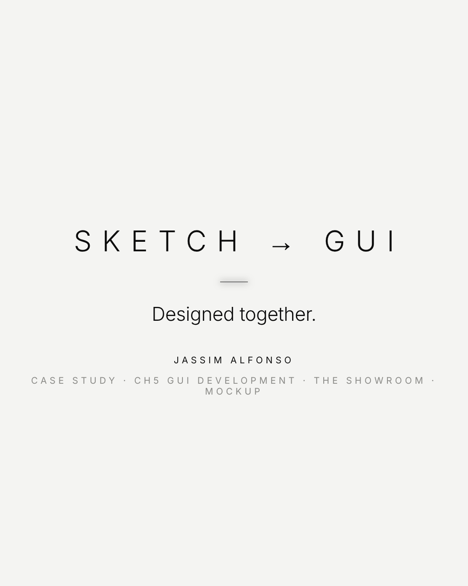

# From Sketch to GUI

**Case study · CH5 GUI development · Jassim Alfonso**
Web technology · AI tools · a collaborative journey

The Showroom is a Crestron CH5 touch panel mockup for home automation. It started as six
boxes in a notebook and became a working panel the same afternoon. This repository is the
case study: the journey below, then the panel itself.

It is a mockup for demonstration, not a client project.

<p></p>

## 01 — The sketch

Six boxes, a few arrows. Pen on paper, a few minutes: an opening screen, the rooms, lighting,
shades, climate and media, and how one leads to the next.

<p></p>

## 02 — The brief

> "A nice minimalist luxury GUI… black on white… glows black or white depending on the theme."

Sent to an AI collaborator (Claude) with a photo of the sketch.

<p></p>

## 03 — The build

Each box becomes a screen.

<p>  </p>

**Web technology, on a touch panel.**

- Hand-written HTML, CSS and JavaScript. No framework.
- One CSS variable flips the glow between black and white.
- CSS transitions and SVG line drawing carry the motion.
- Crestron CrComLib joins. Packed as a `.ch5z` for the panel.

<p></p>

## 04 — The refinement

Looked at together. Changed together.

| Comment | What changed |
|---|---|
| "Is this intentional?" | The outline now fades with the lights |
| "Controls in the cards." | Dim and switch without entering a room |
| "The icons draw themselves. Nice touch." | Now on every entry |
| "Simulate a live tour." | A guided demo, built into the panel |

First pass and sixth pass, side by side. `CHANGES.txt` lists every pass.

<p> </p>

## 05 — The result

A working panel, the same afternoon: lighting, shades, climate, a cinema sequence and a
self-running guided tour, in a light and a dark theme.

<p></p>

- Play it: [`SHARE/Showroom_Demo.html`](SHARE/Showroom_Demo.html) (download and open in a browser)
- Watch it: [social 16:9](VIDEO/Showroom_SketchToGUI_Social_16x9_VO.mp4) · [social 9:16](VIDEO/Showroom_SketchToGUI_Social_9x16_VO.mp4) · [long form](VIDEO/Showroom_SketchToGUI_Long_16x9_VO.mp4)
- The carousel as one file: [`POST/Showroom_Design_Journey_Carousel.pdf`](POST/Showroom_Design_Journey_Carousel.pdf)

## Sketch → GUI

Designed together.

<p></p>

---

# The panel

## Try it

Open `SHARE/Showroom_Demo.html` in a browser (one self-contained file, works offline), or
`SOURCE/index.html`. It is designed at 1280 x 800 landscape and scales to fit.

- Tap or swipe up on the opening screen to enter.
- **Play demo** starts a guided tour: a ghost finger taps and drags through the whole GUI with
  captions, and loops until you touch the screen. Left alone for 3 minutes the panel returns to
  the opening and the tour starts by itself.
- The half-circle button flips between the light and dark theme.

URL options: `?theme=dark|light`, `?demo=1` (loop the tour from load), `?enter=1` (skip the opening).

## What is in it

| Screen | Contents |
|---|---|
| Opening | Wordmark; letters settle in one by one; on enter the word opens out and a line runs to both edges |
| Rooms | Greeting, whole-house Welcome / All off, four room cards with a master dimmer and power button; line art draws itself and lights up with the room |
| Lights | Dim sliders, room-level orb, four scenes with a ramp |
| Shades | Sheer / blackout / drape with live position |
| Climate | Ring set point (drag or - / +), mode and fan |
| Media | Now playing, sources, transport, volume |
| Cinema | One button runs a timed sequence: lights, projector, screen masking, audio |

## How it is built

- Hand-written HTML, CSS and JavaScript. No framework, no build step.
- One CSS variable (`--glow`) flips the glow between black and white with the theme.
- CSS transitions and SVG line drawing carry the motion.
- `SOURCE/js/app.js` holds the rooms, lights, scenes and sources as plain lists at the top.

```
SOURCE/     the panel: index.html, css/app.css, js/app.js, fonts
SHARE/      Showroom_Demo.html - the whole demo in one file
BUILDER/    ch5_pack.py, showroom_pack.py, make_share.py (Python only)
POST/       design-journey carousel (PNG + PDF) and captions
VIDEO/      "From Sketch to GUI" films: social 16:9, social 9:16, long form
```

## Packing for a Crestron panel

The Crestron libraries are not included in this repository. To build a panel file:

1. Get `cr-com-lib.js` from `@crestron/ch5-crcomlib` and `webxpanel.js` from
   `@crestron/ch5-webxpanel` (npm, Crestron licence) and copy them into `SOURCE/js/`.
2. Run `_PACK.bat` (or `python BUILDER/showroom_pack.py <version> "<note>"`). It writes
   `BUILDS/<date>-v<version>/Showroom.ch5z` and refreshes `SHARE/Showroom_Demo.html`.

Without the libraries the GUI still runs in simulation.

### Joins (optional, not yet tested on a processor)

The panel simulates by default and goes live when digital join 1 is high. Room base `B`:
Living 100, Dining 200, Master Bedroom 300, Cinema 400.

| Type | Join | Function |
|---|---|---|
| Digital | 11, 12 | All off, Welcome (pulse) |
| Analog | B+1 .. B+5 | Light level, 0-65535, both ways |
| Digital | B+1 .. B+4 | Scene recall (pulse) |
| Analog | B+21 .. B+23 | Shade position feedback, 65535 = open |
| Digital | B+21+3n, +1, +2 | Shade n open, stop, close (pulse) |
| Analog | B+41, B+42 | Set point x10 (both ways), room temperature x10 |
| Digital | B+41 .. B+48 | Mode Cool / Fan / Auto / Off, fan Low / Med / High / Auto |
| Digital | B+51 .. B+54, B+61 .. B+64 | Sources 1-4; play, pause, previous, next |
| Analog | B+51 | Volume |
| Digital | 471 .. 474 | Cinema start, end, 16:9, Scope |

In live mode the guided tour presses the real controls, so it will drive real joins.

## Credits and licences

- Design and direction: Jassim Alfonso. Build assisted by AI tools.
- Inter typeface: SIL Open Font License (`SOURCE/fonts/inter-LICENSE.txt`).
- Narration and music in the films are synthesized.
- Crestron and CH5 are trademarks of Crestron Electronics; this project is not affiliated with Crestron.
