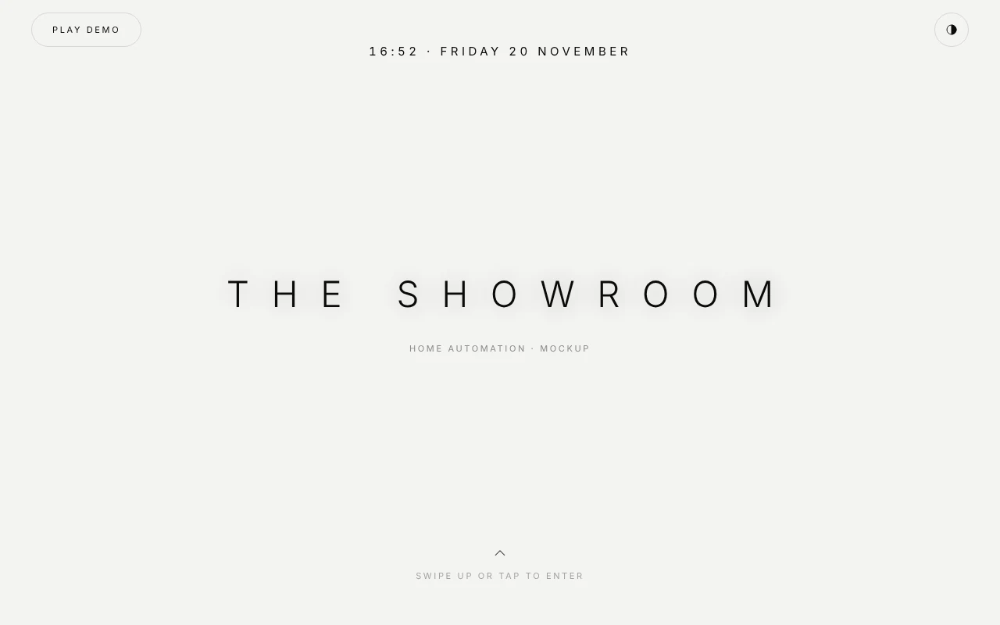
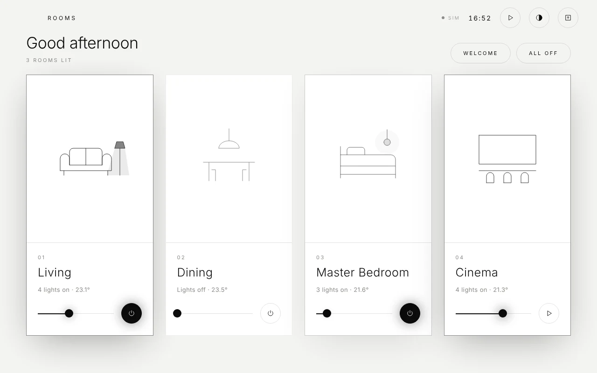
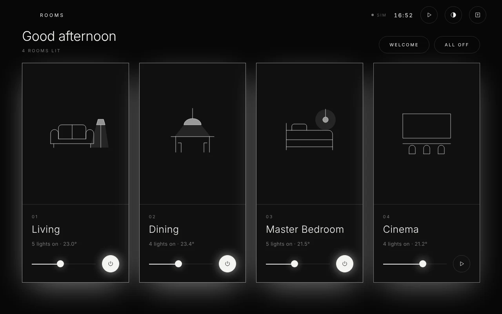
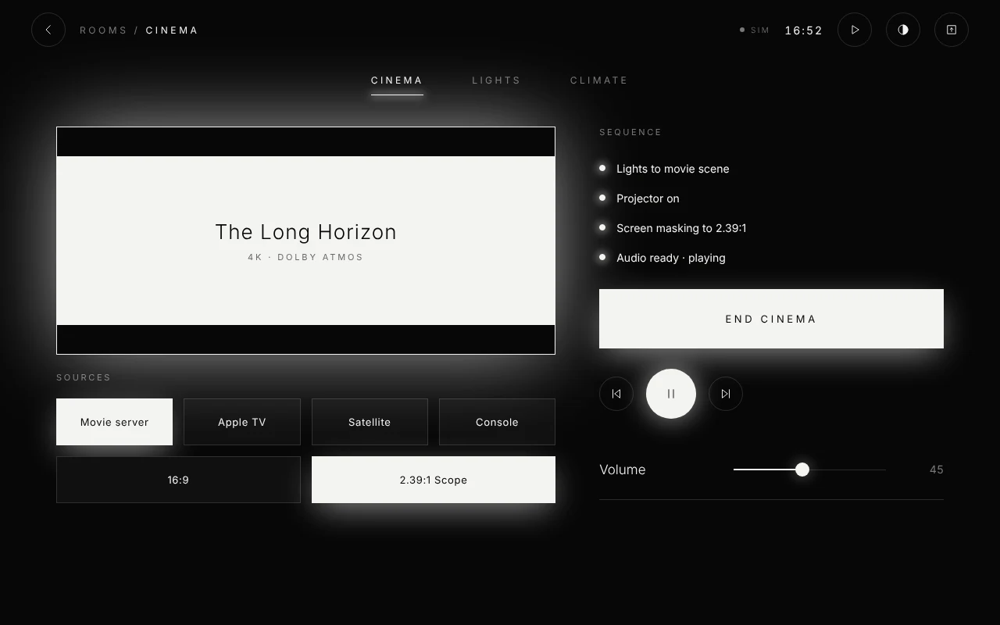
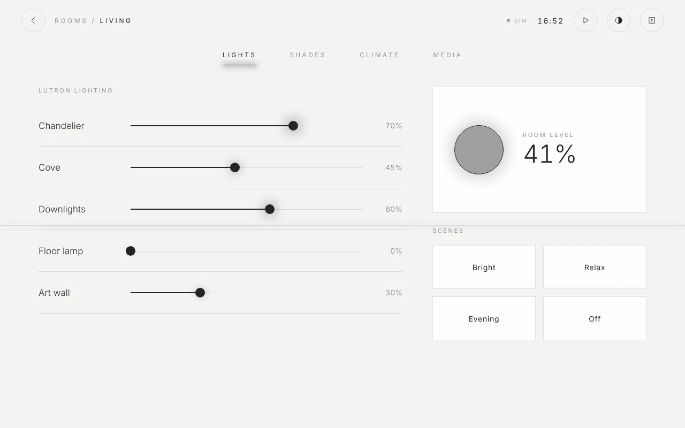
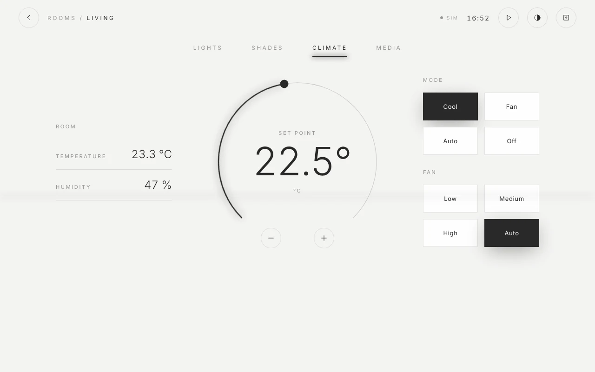
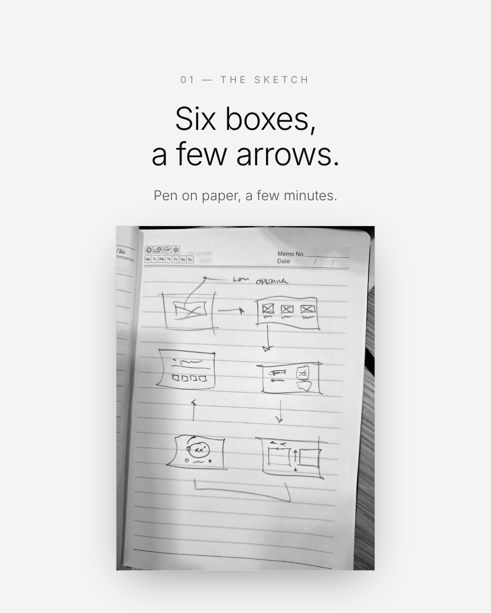
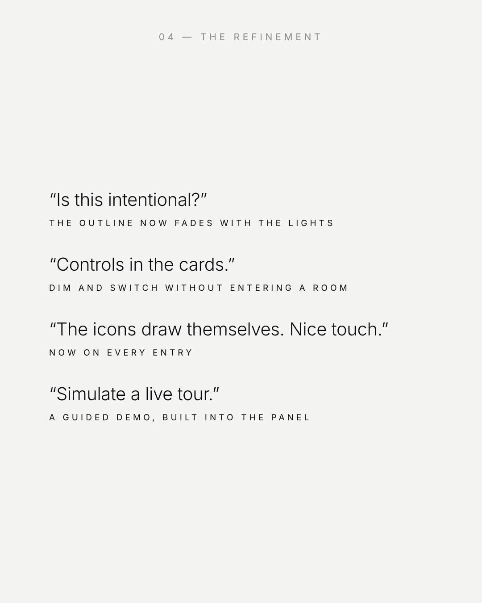
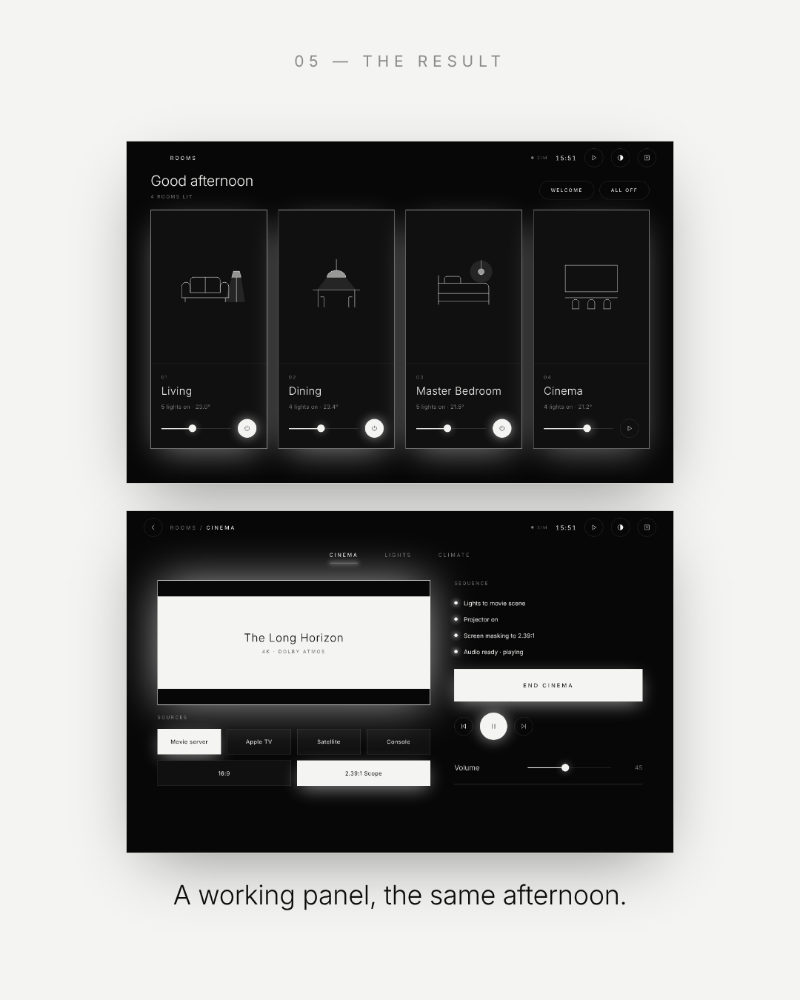

# The Showroom

A Crestron **CH5** touch-panel interface for home automation, drawn first as six boxes in a notebook and built as a working panel the same afternoon. It is a side project and case study in GUI development with web technology, CH5 and AI tools. It has a **built-in demo mode** that simulates the house and tours itself, so it can run unattended in a showroom, in a browser or on a panel before anything is installed.

**Try the demo mode:** open [`SHARE/Showroom_Demo.html`](SHARE/Showroom_Demo.html) in a browser (one self-contained file) and tap **Play demo**. Add `?demo=1` to start the guided tour on load.

| | |
|---|---|
|  |  |
|  |  |
|  |  |

## From sketch to GUI

The interface was designed as a collaboration: the sketch, the brief and every design decision by hand, the build with an AI collaborator (Claude), and the two looked at and changed together.

| | Step | What happened |
|---|---|---|
| 01 | The sketch | Six boxes and a few arrows on paper: opening, rooms, lights, shades, climate, media |
| 02 | The brief | "A nice minimalist luxury GUI… black on white… glows black or white depending on the theme", sent with a photo of the page |
| 03 | The build | Each box becomes a screen, in plain HTML, CSS and JavaScript |
| 04 | The refinement | Each comment becomes a change: "Is this intentional?" → the outline fades with the lights; "Controls in the cards" → dim and switch without entering; "The icons draw themselves" → on every entry; "Simulate a live tour" → the guided demo |
| 05 | The result | A working panel: lighting, shades, climate, cinema, a guided tour, light and dark themes |

<p>    </p>

The full story is in the carousel ([`POST/Showroom_Design_Journey_Carousel.pdf`](POST/Showroom_Design_Journey_Carousel.pdf)) and the films: [social 16:9](VIDEO/Showroom_SketchToGUI_Social_16x9_VO.mp4) · [social 9:16](VIDEO/Showroom_SketchToGUI_Social_9x16_VO.mp4) · [long form](VIDEO/Showroom_SketchToGUI_Long_16x9_VO.mp4). For why CH5 instead of the old VT Pro-e way, see [The Panel.](https://github.com/jassimalfonso/the-panel-ch5)

## What it does

- **Opening** — the wordmark settles in letter by letter; on enter the word opens out and a line runs to both edges
- **Rooms** — greeting, whole-house Welcome / All off, four room cards with a master dimmer and power button; the line art draws itself and lights up with the room, and each card's outline and glow fade with its lights
- **Lights** — dim sliders, room-level orb, four scenes with a ramp
- **Shades** — sheer, blackout and drape with live position
- **Climate** — ring set point (drag, or − / +), mode and fan
- **Media, Cinema** — sources, transport, volume; one button runs the cinema sequence (lights, projector, screen masking, audio)
- **Two themes** — black on white and white on black; the glow follows the theme
- **Demo mode** — a "ghost finger" taps and drags through the whole GUI with captions and loops until someone touches the screen; starts by itself after 3 min idle (showroom attract mode)

URL options: `?demo=1` · `?theme=light|dark` · `?enter=1` (skip the opening) · `?ipId=0B` (connect Web XPanel)

Designed at 1280 × 800 landscape and scaled to fit; there is no portrait or phone layout yet.

## How it's built

```
SOURCE/                the design and the code: index.html + css/app.css + js/app.js + fonts
        │              hand-written, no framework, no build step
        │  python BUILDER/showroom_pack.py  (or ch5-cli archive)
        ▼
BUILDS/<date>-vX.Y/Showroom.ch5z   →  touch panel, Crestron One, or a browser
SHARE/Showroom_Demo.html           →  the same demo in one offline file
```

- One CSS variable (`--glow`) flips the glow between black and white with the theme.
- CSS transitions and SVG line drawing carry the motion.
- The rooms, lights, scenes and sources are plain lists at the top of `SOURCE/js/app.js`.

**Crestron libraries are not included** (Crestron SDK licence). Before packing for a real panel, add them to `SOURCE/js/`:
`cr-com-lib.js` from [`@crestron/ch5-crcomlib`](https://www.npmjs.com/package/@crestron/ch5-crcomlib) and `webxpanel.js` from [`@crestron/ch5-webxpanel`](https://www.npmjs.com/package/@crestron/ch5-webxpanel). The demo-mode file in `SHARE/` doesn't need them.

## Joins (optional, not yet tested on a processor)

The panel simulates by default and goes live when digital join 1 is high. Room base `B`:
Living 100, Dining 200, Master Bedroom 300, Cinema 400.

| Type | Join | Function |
|---|---|---|
| Digital | 11, 12 | All off, Welcome (pulse) |
| Analog | B+1 .. B+5 | Light level, 0-65535, both ways |
| Digital | B+1 .. B+4 | Scene recall (pulse) |
| Analog | B+21 .. B+23 | Shade position feedback, 65535 = open |
| Digital | B+21+3n, +1, +2 | Shade n open, stop, close (pulse) |
| Analog | B+41, B+42 | Set point x10 (both ways), room temperature x10 |
| Digital | B+41 .. B+48 | Mode Cool / Fan / Auto / Off, fan Low / Med / High / Auto |
| Digital | B+51 .. B+54, B+61 .. B+64 | Sources 1-4; play, pause, previous, next |
| Analog | B+51 | Volume |
| Digital | 471 .. 474 | Cinema start, end, 16:9, Scope |

In live mode the guided tour presses the real controls, so it will drive real joins.

## Notes

- This is a mockup and a case study, not a client project and not a project template.
- `CHANGES.txt` has one line per build, v1.0 to v1.7. Several passes *removed* things (the box around the wordmark, the underline, the caption box) to keep it minimal.
- Tested in desktop Chromium only; not yet on a real touch panel.
- Narration and music in the films are synthesized.

Font: Inter — SIL Open Font License (`SOURCE/fonts/inter-LICENSE.txt`). Crestron and CH5 are trademarks of Crestron Electronics; this project is not affiliated with Crestron.

Design and code © Jassim Alfonso. All rights reserved unless a licence is added.
